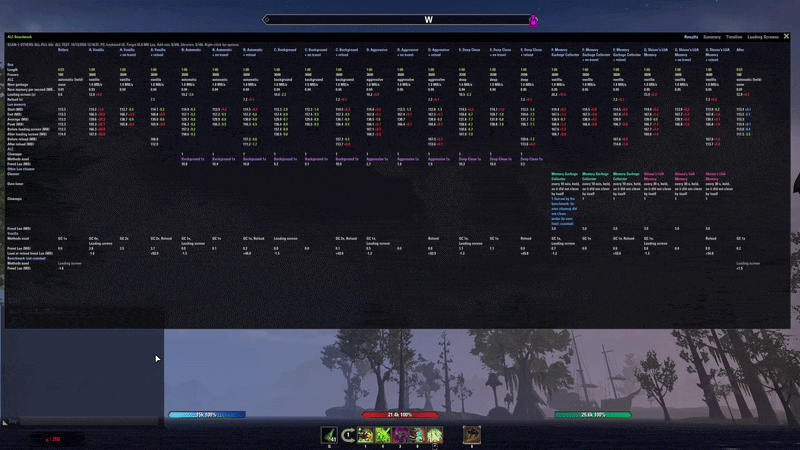
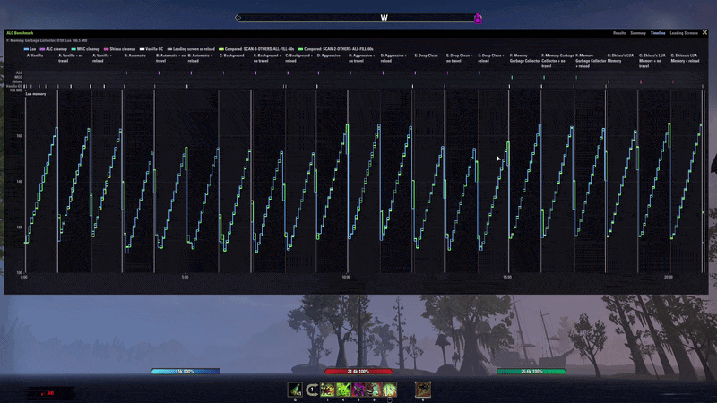
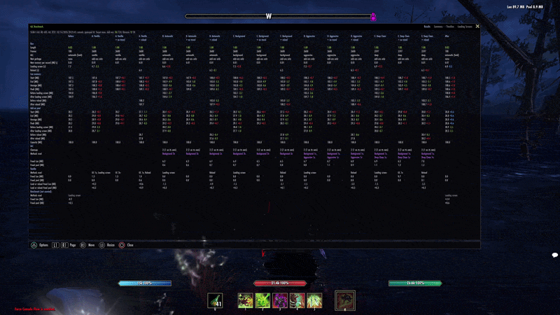
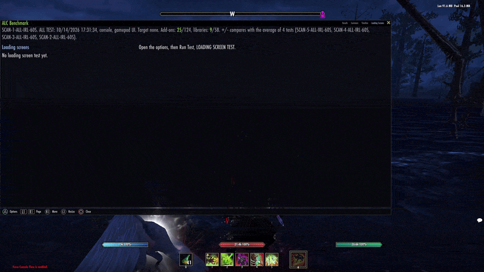
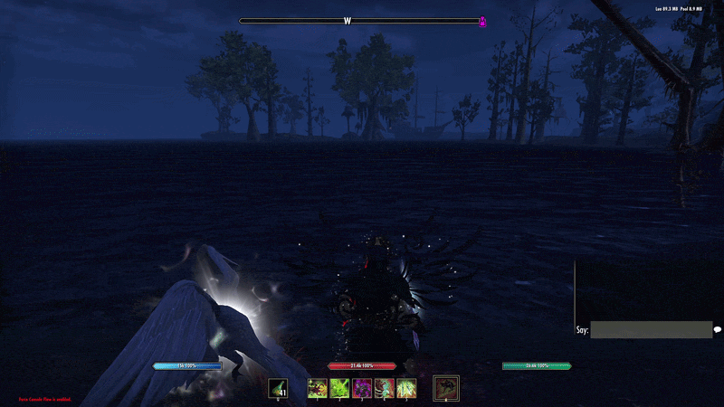
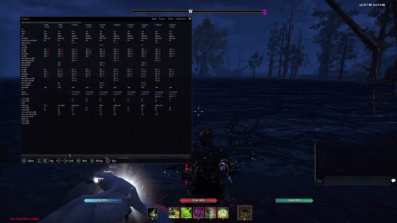

# ALC Benchmark

*Tests every Auto Lua Memory Cleaner method, Memory Garbage Collector and Shissu's LUA Memory against the game on its own, with a loading screen step, and shows Lua memory, the add-on pool and what each freed.*

## Dependencies

Requires **LibAPH** (shared helper library, hard dependency).

Compatible with:
- **Auto Lua Memory Cleaner:** needed for ALL TEST and ALC ONLY TEST.
- **Memory Garbage Collector:** PC; gets its own phases in ALL TEST and a side in LOADING SCREEN TEST when it is installed.
- **Shissu's LUA Memory:** PC; gets its own phases in ALL TEST and a side in LOADING SCREEN TEST when it is installed.

## Demos

<b>PC</b>

**Results summary**

**Timeline**

<b>Console</b>

**Comparing runs**

**Timeline**

**Resizing the window**

**Resizing and moving the window**

## Tests

- **ALL TEST:** Vanilla, every ALC cleanup method (Automatic, Background, Aggressive, Deep Clean), and on PC Memory Garbage Collector and Shissu's LUA Memory, each with and without a loading screen; needs at least one of these cleaners. Every phase starts from a /reloadui. Each cleaner cleans once in each of its own phases, then cleans on its own for the rest of that phase (ALC with your threshold and cleanup delay, the other two on their own timers), and is held outside its own phases. Optional simulated actions (off by default): idling, a short simulated combat and the inventory, then random ones, the same in every phase; Results, Summary and Timeline show what they triggered. The conclusion sets each cleaner against Vanilla and the other two against ALC.
- **ALC ONLY TEST:** the same test without the Vanilla phases.
- **VANILLA ONLY TEST:** Vanilla cleanups without ALC or other cleaners. Every phase starts from a /reloadui, like the ALC tests. Nothing cleans but the game's collector. Needs ALC disabled or its Auto Lua Cleanup off, and any other cleaners you use disabled too.
- **LOADING SCREEN TEST:** times loading screens only, for any mix of Vanilla, ALC, Memory Garbage Collector and Shissu's LUA Memory (the last two on PC). Start inside a house you own: every load is a trip to one other house and back, after a few warm-up loads that are not counted. The same garbage is made before every load; Vanilla travels with it and every other side cleans it first. The order turns every round so drift hits every side alike. The Loading Screens page shows each side's median and spread, and each side against Vanilla with a verdict: faster, slower, about the same, or not settled yet.

Each test runs with test garbage (50 MB held on PC, the add-on pool filled to 65 MB on console, held until 10 s before each phase ends, plus extra MB/s the cleaners can clean; Advanced Test changes both) or as **Real world** (only what your add-ons make), and can add a "+ reload" phase per method.

## What it records

- Lua memory and the add-on pool: start, end, average and peak, plus before and after each loading screen and reload.
- ALC's cleanups, the method each one used and what it freed.
- What Vanilla freed (the game's own collector, and the loading screens and reloads in the phases), listed apart from ALC's; the benchmark's own loading screens before Before and After are left out of the verdict.
- On console, each "Low Add-On memory" warning, marked green when the phase survived it and red when it failed.
- Results, Summary, Timeline and Loading Screens pages in one window. The Summary opens with a conclusion, groups the rest under Best phases, Vanilla and Test, and has a Test time table under the phases: what the test's time went on, next to the total of every test it is compared with.
- Saved tests can be compared, several at a time; the conclusion then says whether they agree. An ALC ONLY TEST and a VANILLA ONLY TEST can also be compared as if they were one ALL TEST.
- A test cut off by a logout, disconnect or crash is kept, and it can be continued from the phase it stopped in.
- Low memory protection (when the game reports an add-on memory limit): the game turns add-ons off at about 90 MB of add-on pool, so a phase keeps running while the pool stays at or below 88 MB, and the game's "Low Add-On memory" warning is only noted. It also acts early when the pool is climbing fast enough to reach 89.5 MB within a second, in every step of the test. The test's own garbage slows down from 85 MB (down to 5% near 88 MB). The moment the pool goes past 88 MB, that phase fails with the pool it reached, and the test saves and reloads at once, before the game can disable the add-ons, and carries on with the next phase. In ALC phases on console ALC keeps the pool down itself from 70 MB, and with ALC's Reload When Add-On Memory Is Almost Full on, its reload counts for the phase and the test carries on. Turned off, the test carries on so you see what the game does. A phase that fails or is cut off shows in red with the reason on every page.
- The window stays closed during a test; a line of text under the compass shows the phase, timer and focus. If you open the window while a phase measures, the Summary says so and how many KB per second its redraws made.
- An edited saved test is marked as edited and invalid, and can't be compared with other tests. A test from another account or server is marked as such, and only tests recorded by the same account can be compared.

## Slash Commands

- `/alcbench`: shows or hides the window.
- `/alcbench alc <seconds> <MB/s> real reload`: starts ALL TEST.
- `/alcbench alconly <seconds> <MB/s> real reload`: starts ALC ONLY TEST.
- `/alcbench vanilla <seconds> <MB/s> real reload`: starts VANILLA ONLY TEST.
- `/alcbench memory`: shows or hides Lua and add-on pool memory at the top right of the screen.
- `/alcbench setfps <FPS or uncapped>`: caps the game at that frame rate (10 to 1000) or removes the cap, in chat and on screen (PC).
- `/alcbenchbugreport`: opens the bug report copy box (PC).
- `/alcbench fill <MB>`: makes that much garbage now.
- `/alcbench stop`: stops the test (or the loading screen test) and keeps what it measured.
- `/alcbench clear`: deletes all saved results.
- `/alcbench help`: prints the command list in chat.

*(seconds, MB/s, real and reload are optional and can go in any order)*

Right-click the window (or press the Options button on a controller) for the tests under Run Test, the saved tests, and the test settings, Memory display and the test status line (under the compass) under Advanced options. On PC the menu also has Set FPS with the current cap in green.

> [!WARNING]
> **Console Testing Notes:** This addon was developed and tested on **PC / Steam Deck** *(using Force Console Flow for console testing)*.

## License

Copyright © 2026 @APHONlC. All rights reserved. See LICENSE.md

> [!NOTE]
> This add-on is not created by, affiliated with, or sponsored by ZeniMax Media Inc. or its affiliates. The Elder Scrolls® and related logos are registered trademarks or trademarks of ZeniMax Media Inc. in the United States and/or other countries. All rights reserved.

For permissions or inquiries, contact @APHONlC on ESOUI.

## Credits

I would like to thank the following, for providing resources and their awesome projects:

- [ESOUI Wiki](https://wiki.esoui.com/Main_Page)
- [ESO Forums](https://forums.elderscrollsonline.com/en/discussion/694799/console-addon-memory)
- [@sirinsidiator](https://github.com/esoui/esoui)

**Check out my other addons/projects:**

- [Auto Lua Memory Cleaner](https://www.esoui.com/downloads/fileinfo.php?id=4388#info)
- [Permanent Memento](https://www.esoui.com/downloads/fileinfo.php?id=4116#info)
- [Tamriel Trade Center, HarvestMap, ESO-Hub, ESOUI Auto-Updater](https://www.esoui.com/downloads/fileinfo.php?id=3249#info) *(Linux, macOS, SteamDeck, & Windows)*

If you like the addon and are considering donating, here's a link. Thank you!

### Bug Reports

If you encounter any issues, please submit a report here
